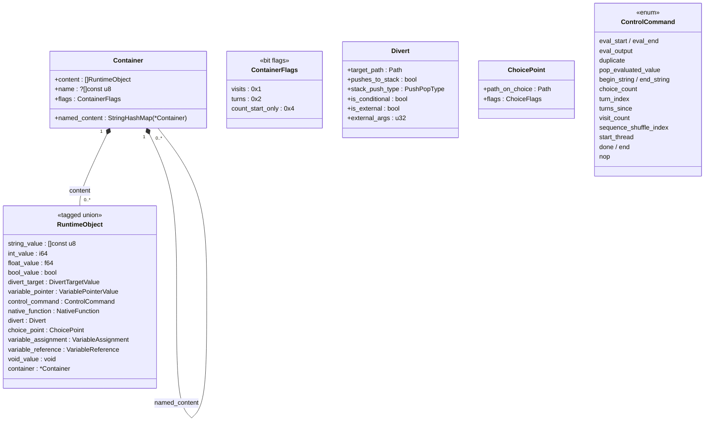
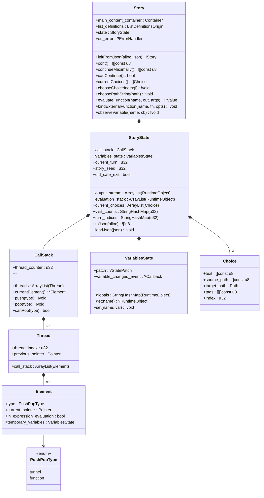
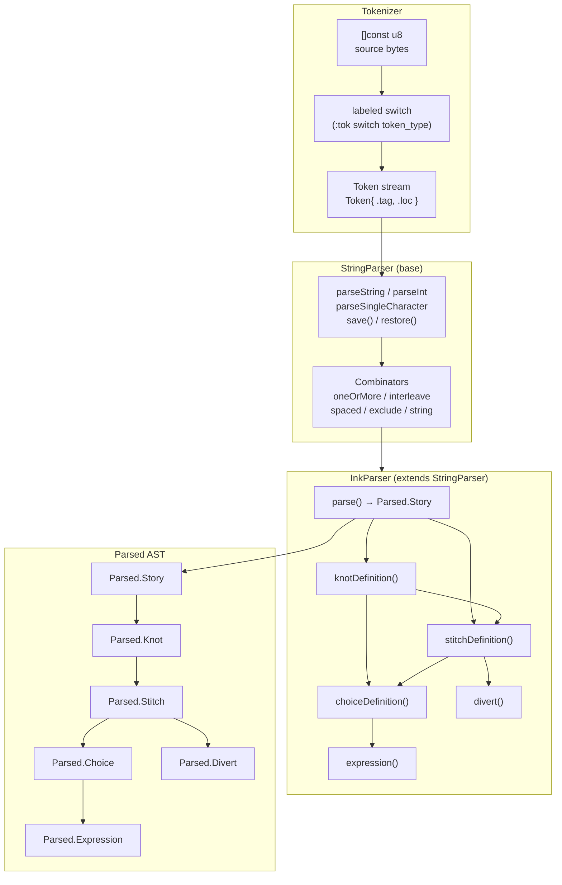
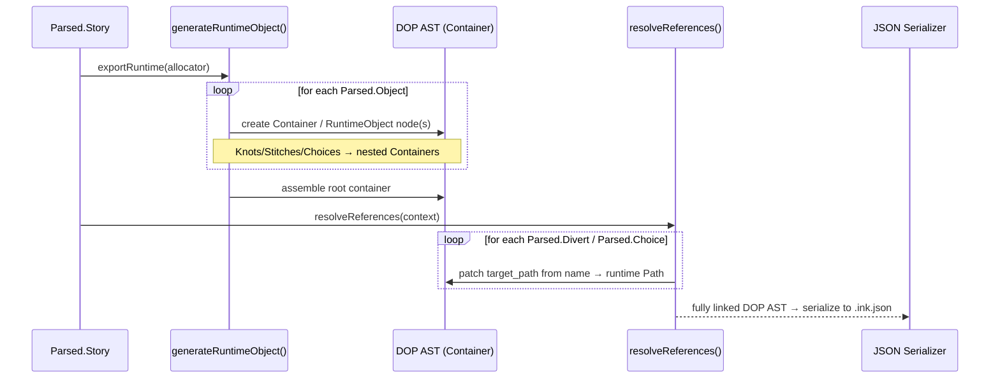
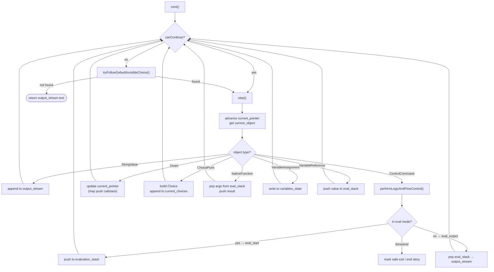
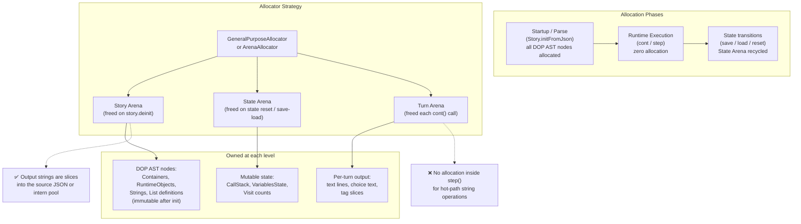

# inkz Architecture

High-level diagrams for the Zig ink runtime and compiler. All diagrams use [Mermaid](https://mermaid.js.org/) syntax.

---

## 1. Full Pipeline Overview

The ink toolchain has two distinct stages: a **compiler** (`.ink` → `.ink.json`) and a **runtime** (`.ink.json` → story output). Both stages share the same **Data Oriented Programming (DOP) AST** — the compiler builds and serializes it to `.ink.json`; the runtime deserializes `.ink.json` back into the same DOP AST and executes it directly. All memory allocation happens at startup or during parsing; there is **zero dynamic allocation** during story execution.

```mermaid
flowchart LR
    subgraph Compiler["Stage 1 — Compiler (inkz)"]
        direction TB
        ink[".ink source\nfiles"]
        Tokenizer["Tokenizer\n(labeled switch)"]
        Parser["Recursive Descent\nParser"]
        ParsedAST["Parsed AST\nParsed.Story"]
        CodeGen["DOP AST Builder\ngenerateRuntimeObject()"]
        RefResolve["Reference Resolver\nresolveReferences()"]
        JSON[".ink.json\n(serialized DOP AST)"]

        ink --> Tokenizer --> Parser --> ParsedAST --> CodeGen --> RefResolve --> JSON
    end

    subgraph Runtime["Stage 2 — Runtime"]
        direction TB
        JSONIn[".ink.json"]
        Loader["JSON Deserializer\nStory.initFromJson()"]
        DOPASTNode["DOP AST\n(same structure as compiler output)\nall memory allocated at startup"]
        Engine["Step Loop\ncont() / step()\nzero allocation during execution"]
        Output["Text Output\n+ Choices"]

        JSONIn --> Loader --> DOPASTNode --> Engine --> Output
    end

    JSON -->|embed or load| JSONIn

    subgraph Host["Host Application"]
        Game["Game Loop\nchooseChoiceIndex()"]
    end

    Output --> Game
    Game -->|next turn| Engine
```



---

## 2. DOP AST Object Model (Compiler & Runtime)

The DOP AST is the shared intermediate representation used by both the compiler (to serialize to `.ink.json`) and the runtime (deserialized from `.ink.json` at startup). It is built from a single general-purpose `Container` type and a tagged union `RuntimeObject` for all content. Node data is stored in flat arrays (see `MultiArrayList` in Guidelines); no virtual dispatch or heap allocation occurs during execution.



---

## 3. Runtime State Machine

All mutable story state is isolated in `StoryState`, enabling save/load by serialising this struct to JSON.



---

## 4. Parser Architecture

The parser is a hand-written recursive descent parser. The tokenizer uses Zig's labeled `switch` for zero-cost dispatch.



---

## 5. DOP AST Construction & Serialization

Two-pass code generation converts the parsed AST into the shared DOP AST, which is then serialized to `.ink.json`. The runtime deserializes that JSON back into the same DOP AST structure — there is no separate "runtime format".



---

## 6. Step Loop & Evaluation Model

The runtime evaluation model: content flows to `output_stream`; logic flows through `evaluation_stack`.



---

## 7. Compiler Stage 2 — Tokenizer (Labeled Switch)

The compiler tokenizer uses Zig's labeled `switch` (`continue :tok`) for a tight, branch-prediction-friendly dispatch loop with no heap allocation.

```mermaid
flowchart LR
    subgraph LabeledSwitch[":tok labeled switch loop"]
        direction TB
        start(["pos = 0"])
        read["ch = source[pos]"]
        sw{"switch ch"}

        start --> read --> sw

        sw -->|'='| scanKnot["scan knot/stitch/function\n→ .knot_marker / .stitch_marker"]
        sw -->|'*' '+' '-'| scanBullet["scan choice/gather bullet\n→ .choice / .gather"]
        sw -->|'{'| scanBrace["scan inline logic\n→ .left_brace"]
        sw -->|'/'| scanComment["check // or /*\n→ .comment / skip"]
        sw -->|'"'| scanStr["scan string literal\n→ .string"]
        sw -->|'~'| scanLogic["scan logic line\n→ .tilde"]
        sw -->|'<' '>'| scanGlue["scan glue / comparison\n→ .glue / .lt / .gt"]
        sw -->|'a'..'z' 'A'..'Z'| scanIdent["scan identifier/keyword\n→ .identifier / .keyword_*"]
        sw -->|'0'..'9'| scanNum["scan integer/float\n→ .int / .float"]
        sw -->|'\\n'| scanNL["emit .newline\nadvance line counter"]
        sw -->|else| scanText["accumulate plain text\n→ .text"]

        scanKnot --> emit["emit Token{ .tag, .loc }"]
        scanBullet --> emit
        scanBrace --> emit
        scanComment --> emit
        scanStr --> emit
        scanLogic --> emit
        scanGlue --> emit
        scanIdent --> emit
        scanNum --> emit
        scanNL --> emit
        scanText --> emit

        emit -->|"continue :tok"| read
        emit -->|"pos >= source.len"| done(["→ .eof"])
    end
```

---

## 8. Memory Strategy

**All** memory allocation happens at startup or during JSON parsing/deserialization. There is **zero dynamic heap allocation** during story execution (`step()`, `cont()`). The DOP AST nodes are allocated once into the Story Arena and remain immutable for the lifetime of the story.


