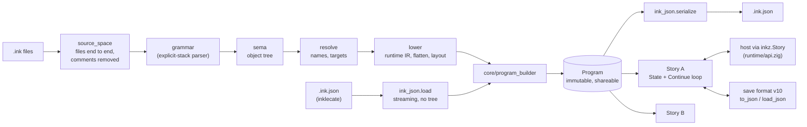
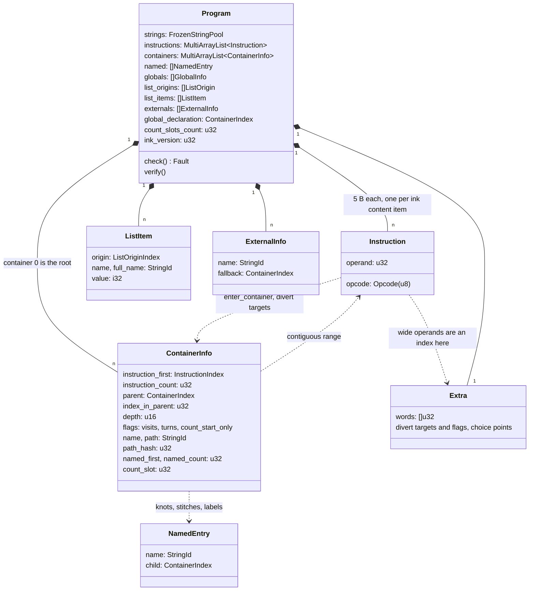
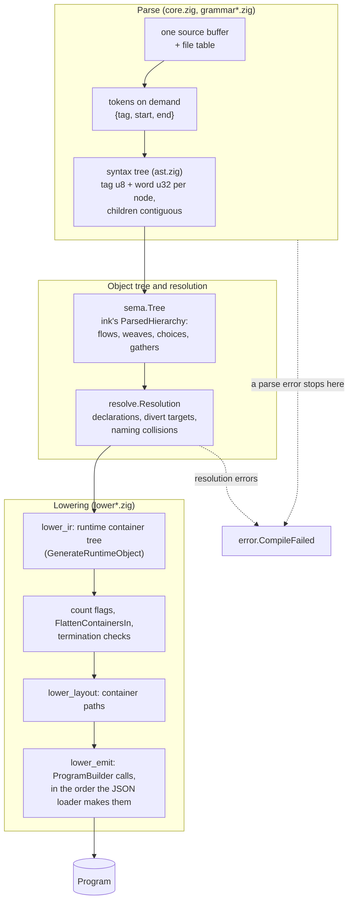
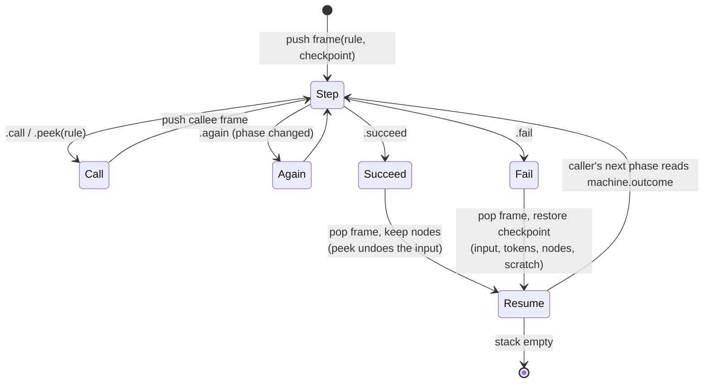
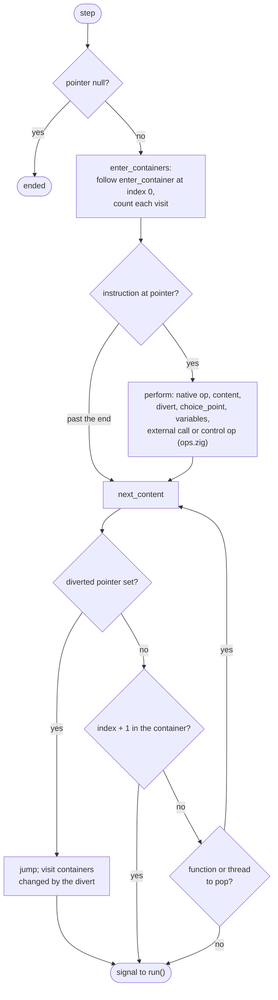
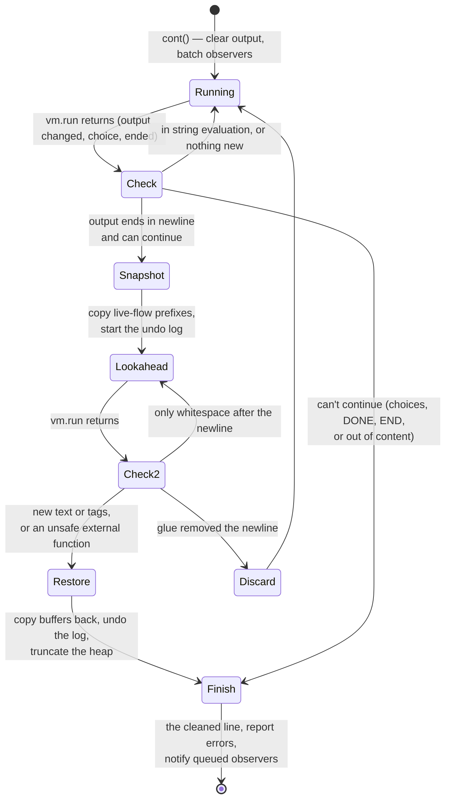
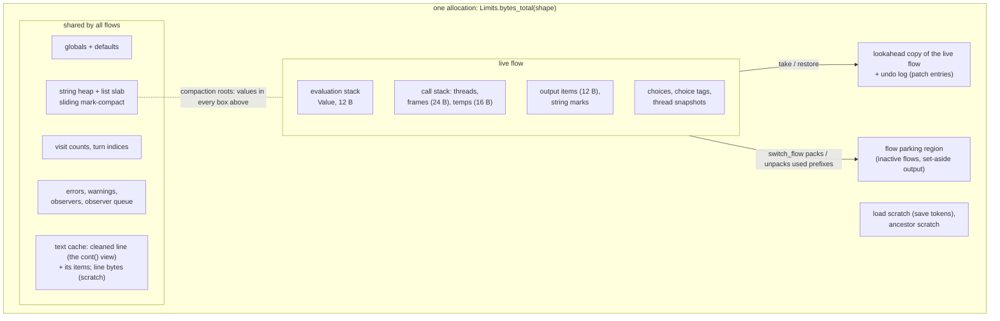

# inkz architecture

Eight diagrams of the code as it is. `docs/ArchitectureAndDevOverview.md` walks through the
same ground in prose; `docs/DODMigrationPlan.md` §4 records why it is built this way. File
names are under `src/` unless they say otherwise.

## 1. Pipeline

Two producers make the same immutable `Program` through one `ProgramBuilder`; stories run
it. A `Program` can be written back as inklecate's JSON.

## 2. The program image

`core/program.zig`. Everything is struct-of-arrays data addressed by `u32` index newtypes;
nothing is a pointer, and every target is resolved when the program is built.

Opcodes group as content (`text`, `newline`, `glue`, `integer`, `float`, `bool`, `void`,
`divert_target`, `variable_pointer`, `list`, `tag`), control (`eval_start`, `string_start`,
`choice_count`, `random`, `start_thread`, `done`, `end`, `tag_start`, ...), ink's native
operators (`add` ... `list_invert`) and structure (`enter_container`, `divert`,
`call_external`, `choice_point`, variable reads and writes, `read_count`).

## 3. Compiler stages and their data

`compiler/compile.zig`. Each stage's output is index-addressed arrays. The object tree, the
resolution and the syntax tree are freed once lowering is done, before layout and emission.

## 4. The parser machine

`compiler/core.zig`. ink's backtracking `StringParser` rules, run on an explicit frame stack
instead of the native one. A rule is a step function with phases; each step returns an
`Action`.

A checkpoint holds the input position and the token, node and scratch counts, so a failed
rule undoes everything since its call; diagnostics survive, as ink's do. Finished nodes sit
on a scratch stack until `wrap` moves a parent's children into one contiguous run. Frames
are bounded by `parse_depth_max` and steps by a gas counter proportional to the input; both
end in a diagnostic, not a crash.

## 5. One VM step

`runtime/vm.zig`: ink's `Step`, `NextContent` and `PerformLogicAndFlowControl`. The pointer
is `{container, index}` in the current frame. `run` repeats `step` until the output changes,
a choice appears, the flow ends, or the step budget runs out.

## 6. The Continue loop and newline lookahead

`runtime/story.zig` and `runtime/lookahead.zig`: ink's `ContinueInternal`. `cont()` returns
one line, but runs past its newline to see whether glue or tags extend it.

Every check needs the current line's cleaned text: ink's `CleanOutputWhitespace` over the
whole output stream. `runtime/text_cache.zig` (P10.1) keeps it between checks, with the
cleaner's state and a copy of the items it came from. While the output only grows and no
heap string changes (`StringHeap.generation`), only new items are cleaned. Any other change
cleans from the start: glue, trimming, `/str`, a restore, a flow switch, a load, heap
truncation or compaction. Debug builds compare every cached line with a full clean. Before
the cache, cleaning took about half of play time; with it, play is 1.5–1.8× faster.

While a snapshot is active, writes to shared arrays (globals, visit counts, turn indices,
the random state) go through the undo log, so a restore needs no copy of them. When the
pointer runs out, an all-invisible default choice is followed automatically; otherwise ink's
end-of-content errors and warnings are raised.

## 7. Memory

`runtime/state.zig`, `runtime/heap.zig`, `runtime/flows.zig`. `Story.init` makes one
allocation of exactly `Limits.bytes_total()` bytes and carves every buffer from it; nothing
allocates afterwards. Views returned to the host point into this block and are valid until
the next mutating call.

The heap is compacted only when an allocation doesn't fit. Compaction keeps allocation
order, so heap marks recorded by the lookahead snapshot stay valid after relocation.
Running out of any buffer returns a named error (`error.HeapLimit`, `error.FlowLimit`, ...).

Every buffer records its peak (P10.2). `Story.usage()` reports them, and `Limits.fitted(usage,
margin)` sizes a story's limits from them. The default budget is about 2.2 MB per story.
Fitted limits need about 40–50 KB for the stories measured, at the same speed, because play
speed doesn't depend on the budget.
