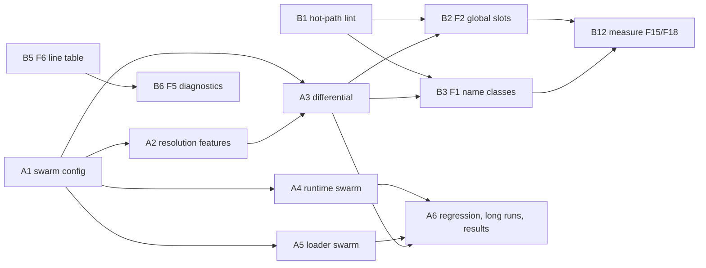

# Phase 16: reference findings and swarm testing

Status: done (2026-11-20). Branch `dod-findings`. Every issue P16.1–P16.21 is closed; P16.21 came out of the first differential run.

**Sources:**
- `docs/DODReferenceComparison.md` §19: the 18 findings F1–F18, each checked at `9018c6d`.
- `docs/fuzzing.md`: the current fuzz targets.
- Groce, Zhang, Eide, Chen, Regehr, "Swarm Testing" (ISSTA 2012).

Work items are git-native issues under the parent **Phase 16: Reference findings and swarm
testing** (`0b3f27d`). Each issue has acceptance criteria that unit tests check.

---

## 1. Goals

**Goals:**
1. Fix every finding from the reference comparison: F1–F18 each get a fix, or a decision
   backed by a measurement.
2. Add swarm testing to every fuzz target that builds structured input, and to the
   simulator.
3. Add a **differential** swarm run against C# ink, so that fuzzing can find semantic
   divergences and not only crashes.
4. Use (2) and (3) as the safety net for the two semantic-risky runtime changes, F1 and F2.

**Non-goals:**
- New ink features.
- API changes beyond F5 (diagnostics) and F17 (trusted image load).
- Changes to the save format.
- The full linearisation of containers (D2 stays).

## 2. Ground rules

These apply to every issue:
- `zig build ci` passes: fmt, lint, all tests, doctest, the fuzz corpus and the zero-alloc
  gate.
- Ground truth stays at 0 divergences. Transcripts are unchanged unless an issue says
  otherwise.
- **No image format change** unless the issue says so. Derived indexes, like F1's name
  classes, are rebuilt on load, the way the string hash index already is.
- Fuzz and swarm runs use ReleaseSafe with bounded counts (`--fuzz=20K`–`100K`), never Debug.
- Every issue keeps its Implementation Notes current and closes with a Final Summary.
- New `zig build` steps never need .NET (D19). The differential run is a mise task.

---

## 3. Workstream A: swarm testing

### 3.1 Why swarm testing

The generator (`src/testing/fuzz_ink.zig`) and the host target (`src/fuzz/host.zig`) offer
every feature in every test case. Swarm testing first draws a **configuration**, a random
subset of features. The case then uses only those features.

This works because of two effects the Groce et al. paper names:
- **Active suppression.** Some features stop others from mattering:
  - an early `-> END` or `-> DONE` ends the story before deeper content runs;
  - `reset_state` and `load_json` in the host target wipe the state that a long sequence built
    up;
  - frequent `save_and_load` hides bugs that need a long-lived lookahead snapshot.
- **Passive dilution.** With all 11 line kinds and 15 term kinds on, any *particular*
  combination is rare. For example, "a deep choice nest with only sequences inside" almost
  never comes up. A configuration with 3 line kinds makes each one dense.

The paper reports more distinct failures found for the same test budget. TigerBeetle's VOPR
uses the same idea with randomised workload mixes.

### 3.2 The swarm configuration (A1)

The configuration lives in `fuzz_ink.zig` next to `Choices`:

```text
Swarm = struct {
    lines:        EnumSet(Line)        // ≥ 1; `text` is forced on if the draw leaves it empty
    terms:        EnumSet(Term)        // ≥ 1; `integer` is the fallback
    operators:    StaticBitSet(16)     // indexes into binary_operators; ≥ 1
    inlines:      EnumSet(Inline)      // the 8 inline constructs (today a u3 switch)
    targets:      StaticBitSet(6)      // k0, k1, k2, k0.s0, END, DONE; ≥ 1 of the knots
    declarations: EnumSet(Declaration) // v0, v1, v2, c0, l0, e0
    lines_max:    u8 in 1..10
    terms_max:    u8 in 1..4
    choice_depth_max: u8 in 0..3
    knots_count:  u8 in 1..3
}
```

- **Drawing.** `Swarm.draw(choices)` reads its bits from `Choices`, so the coverage-guided
  fuzzer learns good configurations and seeded runs can replay them.
  - Each feature is on with probability ½, which is classic swarm.
  - With weight 1/8 the draw returns `Swarm.all`, so the full mix is still covered.
  - The draw is bounded: one bit per feature, then the fallbacks.
- **Picking.** The generator never retries a pick. `pick_enabled(set)` takes `below(count)`
  and returns that set bit. A disabled construct is never written, so no source shape gets
  biased by fallback picks.
- **Reporting.** `Swarm.format(writer)` writes a one-line description, such as
  `lines=text,choice,block terms=integer,call ops=+,< targets=k1,DONE …`. Every failure
  report, and the name of every seeded regression input, includes it.
- **Compatibility.** `Options.swarm: ?Swarm`, where `null` means "draw one". `Swarm.all`
  reproduces today's behaviour bit for bit, so a test can still ask for the full mix.
  Existing Smith corpora in `.zig-cache/f` become stale. That is acceptable: they are a
  cache.

### 3.3 Generator coverage for variable resolution (A2)

F1 and F2 change how ink names resolve, so the generator must first produce the cases where
resolution is subtle:
- `~ temp t0 = …` in knots, stitches and functions.
- Temps that **shadow** globals (`~ temp v0 = …`) and temps named like list items
  (`~ temp a = …`).
- `ref` parameters: `=== function f2(ref x)` called with a global, a temp, and a temp that
  shadows a global, so that `VariablePointer` contexts −1, 0 and n all occur.
- Reads of list items by bare name and by full name (`a`, `l0.a`), in expressions and
  conditions.
- A **globals-count knob**, `globals_extra` in 0..64, that declares `VAR g0 … g63`. It makes
  O(globals) scans visible in benchmarks and makes slot-order bugs likely.
- A second list, `LIST l1 = a, d`, so that the bare item name `a` is ambiguous between the two
  lists, as ink allows.

All of these are swarm features (`declarations`, `terms`, a new `Line.temp`), so a
configuration can hold *only* resolution-heavy content.

### 3.4 Differential swarm against C# ink (A3)

Today the fuzz targets check invariants: no crash, `check()` holds, round trips match. A
differential run also checks **behaviour**:
1. `zig build swarm-gen -- --seed S --count N --out <dir>` writes `<n>.ink`, `<n>.actions`
   (`play_seeded <seed>`, plus optional `set`, `evaluate`, `save`/`load_fresh` actions) and
   `<n>.swarm`, which holds the configuration line.
2. `mise run reference:swarm -- <dir>` runs the harness on each story: `compile` (or records
   the compile errors), then `run`, writing `<n>.expected`.
3. `zig build swarm-check -- <dir>` compiles and plays each story with inkz and compares:
   - **compile acceptance:** both compile, or both fail;
   - **transcripts:** text, choices, tags, globals, errors and warnings, in the transcript
     format of `src/testing/transcripts.zig`;
   - **structure:** inkz's `.ink.json` against inklecate's, through the existing structure
     gate.
4. **Feature-level reduction.** For a divergent story, the checker regenerates it with one
   feature removed at a time from its configuration, and keeps each removal that preserves the
   divergence. Swarm makes this cheap: configurations are small sets, so delta debugging over
   features finishes in |features| rounds.
5. **Promotion.** A reduced divergent case is either fixed, then added to
   `test/ground_truth/swarm/<id>.{ink,actions,expected}`, or recorded in the divergence ledger
   with its reason.

Runs are offline, because .NET is needed. The default budget is 2,000 stories per run, about
minutes. The results table goes into `docs/fuzzing.md`.

### 3.5 Runtime swarm (A4)

- **Host target.** Each input draws `calls: EnumSet(Call)` before its call sequence. `cont` is
  always in the set, so stories advance. The set also decides whether `reset` and
  `save_and_load`, the main suppressors, appear at all.
- **Simulator.** `zig build simulate -- --swarm on` draws an action mix per seed from
  `DotnetRandom(seed)`: which of save/load points, flow switches, `evaluate_function`,
  `set_variable`, `choose_path_string` and compact-always are on, and their weights. The
  configuration is printed in the reproduce command (`--swarm-config <hex>`).
- **Limits swarm** (new target `limits swarm`). Each `Limits` field is drawn as either its
  default or *tight*: a small multiple of what the generated story needs, with heap bytes down
  to a few hundred. The checks:
  - every call returns a result or a **named** limit error, never a crash;
  - `state.check()` holds after every call;
  - after a limit error, the story either fails closed (`error.StoryFailed`) or is back at its
    last line, as `docs/RunningYourInk.md` documents;
  - with `compact_always` drawn as a feature, the heap is compacted before every allocation.
- **Budget property.** If a run's recorded peaks fit inside `Limits.fitted(usage, 1)`,
  replaying it under those limits hits no limit error. That extends `--fit on` into a fuzz
  property.

### 3.6 Loader mutation swarm (A5)

The mutated-input targets (program image, ink JSON, save) apply every mutation operator
uniformly. Each input will instead draw its operator subset:
- **word level:** bit flip, word set to a boundary (`0`, `maxInt`, `none`, `heap_bit`), word
  copied from elsewhere in the image, and swapped neighbouring words;
- **byte level:** truncation;
- **JSON:** token delete, token duplicate, number replaced by a boundary, string replaced by a
  pool name, object key renamed.

A configuration with only "word copied from elsewhere" builds structurally plausible but
cross-wired records. That is exactly what `decodable` and `Program.check` must reject, and the
uniform mix produces it rarely.

### 3.7 Regression, long runs, triage (A6)

- **Seeded regression.** `zig build fuzz` runs 32 seeded swarm inputs plus 8 `Swarm.all`
  inputs per target, keeping today's runtime within 10%. Seeds come from a fixed table, so CI
  is deterministic.
- **Long runs.** `zig build swarm -Doptimize=ReleaseSafe -- --target <filter> --seeds N`. It
  works like `simulate`: seeded, out of the fuzzer, and every failure prints the command and
  configuration that reproduce it.
- **Triage.** The swarm runner counts how often each feature is on in failing and in passing
  runs. A feature that is on in every failing run (or off in every one) is reported as a
  *trigger* (or a *suppressor*), following the paper's §5.
- **Measurement.** For each target, an equal budget (`--fuzz=100K`, ReleaseSafe) is run with
  swarm and with `Swarm.all`, recording coverage, unique runs and crashes in
  `docs/fuzzing.md`. Swarm stays on where it doesn't lose coverage. A target where it loses
  coverage keeps `Swarm.all` as its default, with the numbers as the reason.

---

## 4. Workstream B: findings

Each finding maps to an issue, as listed in §6. These are the design decisions made up front.

- **F3 lint first (B1).**
  - `hot_path` becomes a file list: every runtime file the step reaches, i.e. `vm.zig`,
    `ops.zig`, `native.zig`, `call_stack.zig`, `lists.zig`, `output.zig`, `heap.zig`,
    `text_cache.zig`, `choices.zig`, `lookahead.zig` and `flows.zig`.
  - The forbidden list grows by `strings.find`, `_by_name(` and `global_slot(`.
  - A per-function `// lint: allow hot_path: <reason>` covers legitimate non-play code (load,
    API, path lookup).
  - Today's offenders get a **temporary** suppression `// lint: allow hot_path: P16 F1/F2`.
    B2 and B3 must delete those, and their acceptance checks it. The lint therefore drives
    the fix instead of trailing it.
- **F2 direct global slots (B2).**
  - `global_value(slot)` reads `state.globals[slot]` and follows the name path only for a
    stored `variable_pointer`.
  - `assign_global` writes through the slot and keeps `set_global`, so the lookahead undo log
    still records the write.
  - Blocked by A2 and A3: differential runs with ref parameters must show no divergence.
- **F1 name classes (B3).**
  - `Program.name_classes: []NameClass`, indexed by `StringId`, where
    `NameClass = packed struct(u32) { kind: enum(u2) { none, global, list_item }, index: u30 }`.
    The global wins when a name is both, which keeps `raw_variable`'s order.
  - The table is derived: `ProgramBuilder.finish` builds it, and image load rebuilds it, so
    there is no format change. It costs 4 B per string.
  - `raw_variable` does one table read. For `kind == none` it goes straight to the temps.
  - `assign_temp` uses the same table.
  - Blocked by A2 and A3.
- **F4 one allocation (B4).** Add `externals * @sizeOf(Binding)` to `ProgramShape`, so
  `bytes_total(shape)` covers it and the `Carver` hands it out. The docs stay as they are,
  because they become true.
- **F6 positions (B5), then F5 diagnostics (B6).**
  - `Space.line_starts`, built lazily on the first diagnostic. The file lookup becomes a
    binary search on `File.start`.
  - Then `compile_source_with(gpa, src, .{ .diagnostics = sink })`, with
    `sink.diagnostic(Diagnostic)` where
    `Diagnostic = {severity, code, file, line, column, message: []const u8}`. The message is
    rendered into a scratch buffer and is valid during the call.
  - The ground truth comes from the harness's existing `warnings` command, through a new mise
    task that writes `test/ground_truth/diagnostics/<id>.expected`.
- **F7 named slots (B7).** One slot enum per `fixed(n)` tag, plus `child(node, comptime slot)`.
  A comptime test ties each enum's length to the tag's arity. Sema and lowering move to slot
  names, with no behaviour change.
- **F10 and F11 comptime guards (B8).**
  - `@sizeOf` asserts and `sizes_test.zig` rows for parser `Frame`, `Checkpoint`, the compiler
    `Diagnostic`, IR `Stored`, sema bytes per object, and per token.
  - A new `has_no_pointers(T)`, applied to every `FlowBuffers` element, `PatchEntry`, `Value`,
    `Choice` and `Temp`.
- **F12 single-hash intern (B9).** `getOrPutContextAdapted` with `BytesAdapter`.
- **F13 resolve keys (B10).** Names are interned into a compile-local `StringPool` when sema
  builds objects, keys become `{ObjectIndex, StringId}` (8 B), and the builder reuses the pool
  by freezing it.
- **F14 retry gate (B11).** The e2e corpus compiles with 0 workspace retries; a counter on
  the compile result makes that testable.
- **F15 and F18 measure, then decide (B12).**
  - Profile zones around `call_native` and both save-load passes.
  - Comptime-opcode prongs for native ops are built only if the zone is more than 5% of play.
  - The two-pass load stays, unless a single pass into the idle lookahead buffers keeps
    atomicity and saves more than 30%.
  - Both decisions are recorded in `docs/benchmarks.md`.
- **F17 trusted image load (B13).** `program_image.load_trusted(gpa, bytes)` skips record
  validation and keeps the header and layout checks, plus `Program.verify()` in safe builds.
  It is documented as being for images built by the same binary at build time.
- **F8, F9 and F16 docs (B14).**
  - The token layout in `Architecture.md` and `benchmarks.md`.
  - `Guidelines.md`'s labeled-switch section, which should say that the grammar is
    scannerless and the VM is a plain switch, measured.
  - An "As built" column for plan T1–T19 and the deviations in §1, §4.4 and §4.11.

---

## 5. Order



These are independent and can run in parallel: B4, B7, B8, B9, B10, B11, B13 and B14. B14's
final pass, which refreshes `DODReferenceComparison.md` §19 with each finding's status, is
part of the phase's acceptance.

## 6. Issue map

| Issue | ID | Covers | Blocked by | Priority |
|---|---|---|---|---|
| P16.1 Swarm configuration for the ink generator | `0e7f43b` | A1 | – | high |
| P16.2 Generator: temps, ref parameters, shadowing, list item names, many globals | `4d07d5c` | A2 | P16.1 | high |
| P16.3 Differential swarm against C# ink, with feature-level reduction | `054b1e4` | A3 | P16.1, P16.2 | high |
| P16.4 Runtime swarm: host-call mix, simulator `--swarm`, limits swarm | `5cec14d` | A4 | P16.1 | medium |
| P16.5 Loader mutation swarm: image, JSON, save | `97e8a25` | A5 | P16.1 | medium |
| P16.6 Swarm regression seeds, `zig build swarm`, triage, measured results | `7d70b41` | A6 | P16.3, P16.4, P16.5 | medium |
| P16.7 Hot-path lint covers every step file | `f639723` | F3 | – | high |
| P16.8 Global reads and writes go through the resolved slot | `f0903d7` | F2 | P16.3, P16.7 | high |
| P16.9 Name-class table: temps and list items without scans or hashing | `7edece0` | F1 | P16.3, P16.7 | high |
| P16.10 `Story.init` makes exactly one allocation | `ecb2bc5` | F4 | – | medium |
| P16.11 Line-start table and binary file lookup for positions | `ac539d0` | F6 | – | medium |
| P16.12 Compiler diagnostics reach the caller | `ffa19cc` | F5 | P16.11 | medium |
| P16.13 Named child slots for fixed-arity AST nodes | `fb2d519` | F7 | – | medium |
| P16.14 Comptime guards: missing size asserts and `has_no_pointers` | `616c249` | F10, F11 | – | low |
| P16.15 `StringPool.intern` hashes once | `d72f95f` | F12 | – | low |
| P16.16 Resolve keys by `StringId` | `8f44cec` | F13 | P16.15 | low |
| P16.17 No workspace retry on the e2e corpus | `38243b6` | F14 | – | low |
| P16.18 Measure native dispatch and save-load passes, record decisions | `197204f` | F15, F18 | P16.8, P16.9 | low |
| P16.19 Trusted program image load | `98ee677` | F17 | – | low |
| P16.20 Docs match the code: tokens, labeled switches, plan as built | `599500c` | F8, F9, F16 | – | medium |

## 7. Risks

| Risk | Mitigation |
|---|---|
| F1 or F2 changes ink's resolution order in an edge case | A2 generates the edge cases; A3 compares against C# before the change lands; ground truth gates every commit |
| Swarm lowers coverage on a target | A6 measures with and without at an equal budget; that target keeps `Swarm.all` |
| The differential run is slow or flaky (.NET start-up) | One harness process per batch, not per story; fixed seeds; offline only |
| Divergences turn out to be intentional (ledger cases) | Promotion step: fix, or a ledger entry with its reason; never silently dropped |
| B1's temporary suppressions linger | B2 and B3 acceptance requires `grep 'P16 F1/F2'` to return nothing |
| Generated stories get bigger (globals knob), so fuzzing slows | `globals_extra` is a swarm knob, often 0; `source_bytes_max` is checked |

## 8. Phase acceptance

- [x] P16.1–P16.20 closed, each with its tests (and P16.21, found on the way).
- [x] `zig build ci` passes on macOS (34/34 steps, 475 tests). GitHub CI runs when the
      branch is pushed.
- [x] Ground truth 0 divergences (191 cases, empty ledger). A differential swarm run of
      10,000 stories has 0 divergences (`docs/fuzzing.md`).
- [x] `docs/fuzzing.md` has the swarm results table. `docs/benchmarks.md` has the F15/F18
      decisions, the F13 decision and a play benchmark before and after F1/F2.
- [x] `docs/DODReferenceComparison.md` §19 shows each finding's status.
